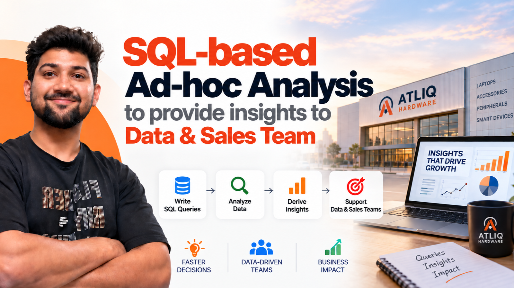

# SQL-Based Ad-hoc Consumer Goods Analytics



**Codebasics Resume Project Challenge #4 | Consumer Goods Domain**

An end-to-end SQL analytics project focused on answering business questions and generating actionable insights for AtliQ Hardwares, a fictional computer hardware company.

## Project Overview

AtliQ Hardwares operates across multiple markets and sales channels. However, its management needs faster access to data-driven insights to make informed business decisions.

As part of this project, I worked on 10 ad-hoc business requests using MySQL to analyze sales performance, product distribution, manufacturing costs, customer discounts, and channel contributions.

The objective was to transform raw business data into meaningful insights that can support management decision-making.

## Business Problem

AtliQ Hardwares (imaginary company) is one of the leading computer hardware producers in India and has expanded well in other countries too.

However, the management noticed that they do not get enough insights to make quick and smart data-informed decisions. They want to expand their data analytics team by adding several junior data analysts. Tony Sharma, their data analytics director, wanted to hire someone good at both tech and soft skills. Hence, he decided to conduct a SQL challenge, which will help him understand both skills.

## Tools & Technologies

- **Database:** MySQL
- **Query Language:** SQL
- **Presentation:** Microsoft PowerPoint
- **Version Control:** Git & GitHub

## SQL Skills Demonstrated

This project demonstrates practical application of:

- Data Retrieval and Filtering
- Aggregate Functions
- Joins and Multi-table Analysis
- GROUP BY and HAVING
- Common Table Expressions (CTEs)
- Subqueries
- Window Functions
- RANK() and PARTITION BY
- Date and Fiscal Year Analysis
- Percentage and Growth Calculations
- Query Formatting and Optimization

## Business Requests Analyzed

| # | Business Request | Analysis Objective |
|---|---|---|
| 01 | APAC Markets | Identify markets where AtliQ Exclusive operates in the APAC region. |
| 02 | Unique Product Growth | Calculate the percentage increase in unique products in FY2021 compared with FY2020. |
| 03 | Product Count by Segment | Analyze unique product counts across different product segments. |
| 04 | Segment-wise Product Growth | Identify the segment with the highest increase in unique products. |
| 05 | Manufacturing Costs | Identify products with the highest and lowest manufacturing costs. |
| 06 | Customer Discounts | Find the top five Indian customers with the highest average pre-invoice discount in FY2021. |
| 07 | Monthly Gross Sales | Analyze monthly gross sales generated by AtliQ Exclusive. |
| 08 | Quarterly Sales Quantity | Identify the quarter with the highest total sold quantity in FY2020. |
| 09 | Channel Contribution | Analyze gross sales contribution by sales channel in FY2021. |
| 10 | Top Products by Division | Identify the top three products by sold quantity within each division in FY2021. |

## Key Business Insights

Some of the important findings from the analysis include:

- **Product Portfolio:** Notebooks had the highest unique product count, with 129 products, while Networking had the lowest, with 9.
- **Product Growth:** Accessories recorded the largest increase in unique products between FY2020 and FY2021.
- **Manufacturing Costs:** AQ Master Wired x1 Ms had the lowest manufacturing cost at $0.89, while AQ Home Allin 1 Gen 2 had the highest at $240.54.
- **Quarterly Performance:** Q1 recorded the highest total sold quantity in FY2020.
- **Sales Channels:** Retailers contributed 73.22% of total gross sales in FY2021.

## Database Overview

The analysis uses the AtliQ Hardware database, consisting of six tables:

| Table | Description |
|---|---|
| dim_customer | Customer, market, region, and channel information |
| dim_product | Product, segment, category, and division details |
| fact_sales_monthly | Monthly product sales and sold quantities |
| fact_gross_price | Product gross pricing by fiscal year |
| fact_manufacturing_cost | Product manufacturing costs |
| fact_pre_invoice_deductions | Customer pre-invoice discount information |

**Fiscal Year:** September to August.

## Repository Structure

```text
SQL-based-Ad-hoc-Consumer-Goods-Analytics/
│
├── README.md
│
├── sql/
│   └── AD_HOC_Requests.sql
│
├── documentation/
│   ├── Metadata.txt
│   └── ad-hoc-requests.pdf
│
└── presentation/
    ├── RPC4.pptx
    └── RPC4-OfficialThumbnail.png
```

## Project Deliverables

- SQL script containing all 10 business queries.
- Database metadata and original business requests.
- Project presentation explaining the analysis and findings.

## Acknowledgement

This project was completed as part of the **Codebasics Resume Project Challenge #4**, focused on providing insights to management in the consumer goods domain.

## Author

**Aryan Pokhriyal**

Data Analyst | SQL | Power BI | Microsoft Fabric

- [Check Out my LinkedIn](https://www.linkedin.com/in/aryanpokhriyal/)
